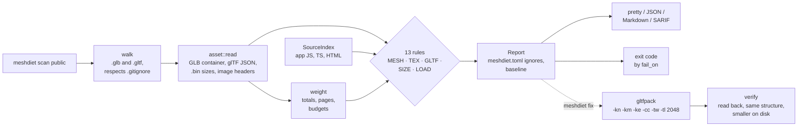
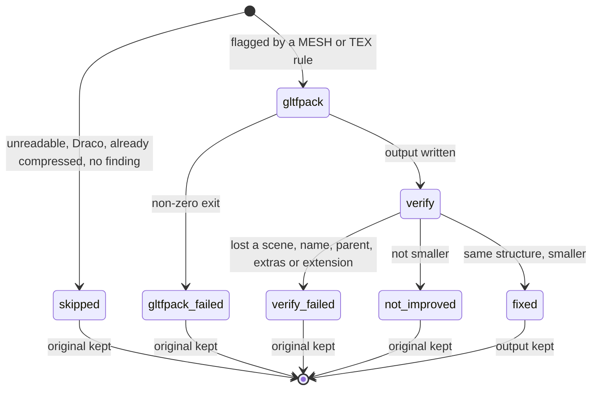
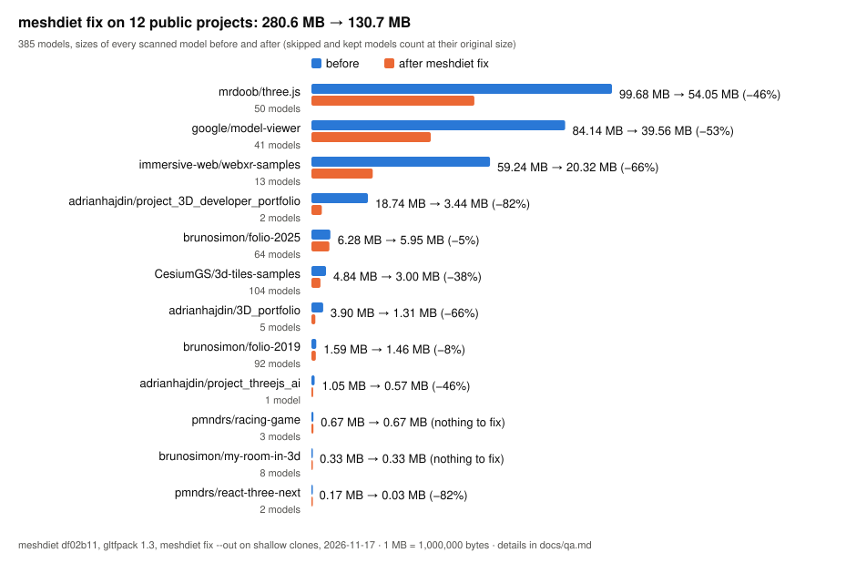

# meshdiet

meshdiet finds the 3D models that make a website slow. It reads the `.glb` and `.gltf` files your
site ships, tells you which ones are heavy and why, and can hand them to gltfpack to make them
smaller. It runs on your machine, reads headers only, and sends nothing anywhere.



## Why it exists

A 3D shop page we audited shipped 37 models with no geometry compression, 49.8 MB between them.
Nothing about that is hard to fix with the tools that already exist. It is just easy to miss when
models arrive one at a time and nobody adds up the total. meshdiet is the check we wanted on that
site's pull requests, with the numbers in front of the person who merges.

## Install

```bash
cargo install --locked meshdiet
```

Or download the binary for your system from [Releases](https://github.com/uniqtechteam/meshdiet/releases):
Linux (x86_64 and aarch64, static), macOS (Intel and Apple silicon) and Windows, with a
`SHA256SUMS` file. In GitHub Actions, use `uses: uniqtechteam/meshdiet@v0` ([CI](#in-ci)).

`meshdiet fix` also needs [gltfpack](https://github.com/zeux/meshoptimizer/tree/master/gltf) 1.3 or
newer, one file from the [meshoptimizer releases](https://github.com/zeux/meshoptimizer/releases).
The audit itself needs nothing else.

## Quick start

```bash
meshdiet scan public          # or dist, or wherever your models are
meshdiet fix public --dry-run # what gltfpack would save, nothing written
```

`scan` exits with `1` when it finds something at or above `--fail-on` (`high` by default), so it can
stop a deploy. This is the demo site from `tests/fixtures/demo-site`, a small three.js page with
problems planted on purpose:

```console
$ meshdiet scan demo-site
public/models/hero.glb  5.1 MB
  high    MESH-001  1 primitive, 1.3 MB of uncompressed geometry
          Fix: Run `meshdiet fix` on this file (gltfpack, meshopt), or `gltf-transform draco in.glb out.glb` if you need Draco; then make sure the app loads the decoder (LOAD-001).
  high    SIZE-001  5.1 MB, over the 5.0 MB file budget: geometry 1.3 MB, textures 3.8 MB, other 1.2 KB. Biggest image: hero-photo (1400x1400 JPEG, 3.8 MB)
          Fix: Compress the geometry and textures (`meshdiet fix`, or `gltfpack -cc -tc`), shrink oversized textures, or raise file_max in meshdiet.toml if this size is intended.

public/models/chair.glb  19.0 KB
  medium  LOAD-001  1 meshopt-compressed model, but none of the 2 source files mention MeshoptDecoder: public/models/chair.glb  (check by hand)
          Fix: Add `import { MeshoptDecoder } from 'three/addons/libs/meshopt_decoder.module.js'` and `loader.setMeshoptDecoder(MeshoptDecoder)`, or load with drei `useGLTF`. If the app code is outside the scanned folder, pass it with `--src`.

[four more findings: TEX-004 on hero.glb, TEX-003 on lamp.gltf, TEX-001 and TEX-002 on sofa.glb]

Weight, largest first
  file                        total  geometry  textures  compression  GPU (est.)
  public/models/hero.glb     5.1 MB    1.3 MB    3.8 MB  none            10.5 MB
  public/models/lamp.gltf  307.4 KB   35.0 KB  270.4 KB  none           480.0 KB
  public/models/sofa.glb   106.7 KB   46.8 KB   58.7 KB  none            89.5 MB
  public/models/chair.glb   19.0 KB   14.8 KB    1.6 KB  meshopt        349.5 KB

4 files · 5.6 MB · 1 uncompressed (5.1 MB) · 2 high · 4 medium · 1 low · scanned in 0.00s
```

The image at the top is the same run, made by `scripts/demo_svg.py` from the binary's own output.

## How it works



Nothing is decoded during a scan: meshdiet reads the GLB container, the glTF JSON and the first bytes
of each image, which is enough to know sizes, formats, triangle counts and compression. That is why
the 12 public projects in [docs/qa.md](docs/qa.md), 385 models and 280.6 MB, took 379 ms in total.
On a generated set of 200 models and 519 MB, `cargo test --release -p meshdiet-core --test speed --
--ignored --nocapture` reported 118 to 178 ms over four runs (i7-12700, Linux, 2026-11-17). `fix` is
the only command that runs another program, and only when you ask for it.

## What it checks

| Rule | Severity | Finds |
|---|---|---|
| MESH-001 | high | Geometry with no Draco or meshopt compression, from 64 KB (medium when it is already quantized) |
| MESH-002 | medium | The default scene draws more than 500,000 triangles |
| MESH-003 | low | Buffer bytes that nothing in the model uses |
| TEX-001 | medium | An image wider or taller than 2048 px, with its estimated GPU memory |
| TEX-002 | low | PNG, JPEG, WebP or AVIF textures over an estimated 32 MB of GPU memory, where KTX2 would take about a quarter |
| TEX-003 | medium | A PNG over 256 KB that cannot be transparent, so JPEG or WebP would be far smaller |
| TEX-004 | medium | An image over 1 MB |
| GLTF-001 | high | A file that cannot be read: broken container, invalid JSON, a missing `.bin` or image |
| GLTF-002 | medium | A `.gltf` that stores a buffer or image as base64 over 16 KB |
| SIZE-001 | high | One model (with its `.bin` and images) over `file_max`, 5 MB by default |
| SIZE-002 | high | Everything scanned together over `build_max` (off unless set) |
| SIZE-003 | high | One page's models over that page's `max` |
| LOAD-001 | medium | Models use Draco, meshopt or KTX2, but the app never sets up that decoder (a text search, so "check by hand") |

`meshdiet rules` prints this list, and `meshdiet explain MESH-001` says why a rule matters, how to fix
it with gltfpack or glTF Transform, and what the three.js loader needs afterwards. Every size is
measured from the file; GPU memory is always labelled "est." because it depends on mipmaps and the
driver. Three more ids come from your setup rather than a model: BASE-GROW (a file grew past the
baseline), CFG-IGN (an ignore with no reason) and CFG-PAGE (a page glob that matches nothing).

## Budgets and pages

A `meshdiet.toml` next to where you run it sets the gate, the budgets, and which models each page
loads:

```toml
fail_on = "high"
ignore = [
  { rule = "TEX-001", path = "public/models/sofa.glb", reason = "fabric close-up, shown full screen" },
]

[budgets]
file_max = "5 MB"
build_max = "4 MB"

[pages]
"/" = { assets = ["public/models/hero.glb", "public/models/chair.glb"], max = "3 MB" }
"/shop" = { assets = ["public/models/sofa.glb", "public/models/lamp.gltf"], max = "1 MB" }
```

With that file in the demo site, the scan adds SIZE-002 and SIZE-003 findings and ends like this:

```console
$ meshdiet scan demo-site
[findings and weight table]

Pages
  page   assets     total     max
  /           2    5.2 MB  3.0 MB  over budget
  /shop       2  414.1 KB  1.0 MB  ok

4 files · 5.6 MB · 1 uncompressed (5.1 MB) · 4 high · 3 medium · 1 low · 1 ignored · scanned in 0.00s
```

Sizes are decimal (1 MB = 1,000,000 bytes). Unknown keys and rule ids stop the scan with exit code
2, so a typo never switches a check off quietly. Every key is in [docs/config.md](docs/config.md).

## On a site that is already heavy

Record where you are today, commit the file, and let CI fail only when something new appears or a
model grows by more than 1%:

```console
$ meshdiet scan demo-site --write-baseline meshdiet-baseline.json --quiet
meshdiet: wrote 7 findings and 4 files to meshdiet-baseline.json
4 files · 5.6 MB · 1 uncompressed (5.1 MB) · 2 high · 4 medium · 1 low · scanned in 0.00s
$ meshdiet scan demo-site --baseline meshdiet-baseline.json --quiet
4 files · 5.6 MB · 1 uncompressed (5.1 MB) · 0 high · 0 medium · 0 low · 7 in baseline · scanned in 0.00s
```

A file or a build that grew past `--tolerance` is reported as BASE-GROW. Removed and smaller files are
listed as improvements, so the baseline only ever moves one way.

## Fixing what it finds

`meshdiet fix` runs gltfpack on the models that have a MESH-001 or TEX finding and writes the results
to `meshdiet-out/` (or `--out`):

```console
$ meshdiet fix demo-site --out demo-site-fixed
gltfpack 1.3 (~/.local/bin/gltfpack) with -kn -km -ke -cc -tw -tl 2048

public/models/chair.glb  19.0 KB  skipped
    no MESH-001 or TEX finding; --all compresses it anyway
public/models/hero.glb   5.1 MB → 1.6 MB  −70%  fixed
public/models/lamp.gltf  307.4 KB → 72.5 KB  −76%  fixed
    note: written as public/models/lamp.glb (one file); change the path your code loads, or pass --keep-gltf
public/models/sofa.glb   106.7 KB → 17.8 KB  −83%  fixed

4 files · 5.6 MB → 1.7 MB (−70%) · 3 fixed, measured on disk
Written to demo-site-fixed/ (models not fixed are copied as they are).

The fixed models use meshopt compression; tell three.js how to read them:

  import { MeshoptDecoder } from 'three/examples/jsm/libs/meshopt_decoder.module.js';
  loader.setMeshoptDecoder(MeshoptDecoder);

Then run `meshdiet scan demo-site-fixed` again (LOAD-001 checks the decoder wiring).
$ meshdiet scan demo-site-fixed --quiet
4 files · 1.7 MB · 0 high · 1 medium · 0 low · scanned in 0.00s
```

What it keeps: gltfpack always runs with `-kn -km -ke`, so named nodes, named materials and extras
survive, and meshdiet never asks it to simplify a mesh. Each output is read back and kept only when it
has the same scenes, the same named nodes under the same parents, the same named materials and
extras, the same extensions and custom vertex attributes, and is smaller on disk. Anything else keeps
the original:



What it never does: download gltfpack (only the GitHub Action does, at a pinned version with a
checked SHA-256), overwrite your files unless you pass `--in-place` (and then only files git has a
clean copy of, unless you add `--force`), write Draco, or estimate a saving. Every size it prints was
measured on disk afterwards. Textures go to WebP by default; `--textures ktx2` keeps them compressed
on the GPU but needs `KTX2Loader` in the app, and `--textures keep` leaves them alone.

## In CI

```yaml
# .github/workflows/meshdiet.yml
name: meshdiet
on: [pull_request]

permissions:
  contents: read
  security-events: write   # only for the SARIF upload; drop it with `sarif: "false"`

jobs:
  models:
    runs-on: ubuntu-latest
    steps:
      - uses: actions/checkout@v4
      - uses: uniqtechteam/meshdiet@v0
        with:
          path: public
          fail-on: high
```

The Action installs the meshdiet release for the runner (SHA-256 checked), writes the findings and
the weight table to the job summary, uploads SARIF to code scanning and fails the job at `fail-on`.
It needs no Rust on the runner and never uploads your models; the summary and SARIF hold paths and
numbers only. Inputs, outputs, running `fix` in a workflow, and other CI systems are in
[docs/ci.md](docs/ci.md).

## Tested on 12 public projects

Before the first release we ran meshdiet on 12 public projects that ship glTF models, among them
[three.js](https://github.com/mrdoob/three.js) `examples/models`,
[model-viewer](https://github.com/google/model-viewer),
[webxr-samples](https://github.com/immersive-web/webxr-samples) and
[3d-tiles-samples](https://github.com/CesiumGS/3d-tiles-samples), and checked every finding by hand.

- 385 models, 280.6 MB, scanned in 379 ms in total.
- 211 findings, all checked against the glTF JSON and image headers, 0 false positives left. The 11
  false positives the first run found were fixed and became tests.
- `meshdiet fix` changed 79 models: 224.7 MB → 71.0 MB (−68%). Five more were kept as they were,
  because gltfpack would have dropped an extension or a custom vertex attribute they use.



Most of these are examples, starters and test models, chosen to vary, so the numbers say what meshdiet
does on real files, not how those projects' own pages load. The full record, project by project, is
in [docs/qa.md](docs/qa.md); the chart is drawn by `scripts/qa_chart.py` from
`docs/data/qa-fix.json`.

## Limits

- It reads files, not a running page. It does not know which models a page loads unless you list them
  under `[pages]`, and it cannot see lazy loading.
- LOAD-001 is a text search for decoder setup in three.js-family apps (three.js, React Three Fiber
  with drei, `<model-viewer>`). Babylon.js apps are skipped, and other engines are not covered.
- GPU memory figures are estimates and are labelled as such.
- `fix` writes meshopt geometry, never Draco. If your app only has a Draco decoder, add
  `setMeshoptDecoder` or use glTF Transform's `draco` command instead.
- Textures inside the model are checked; images your app loads separately (a baked lightmap JPEG, an
  HDR environment) are not.

## Credits

`meshdiet fix` is a careful wrapper around [gltfpack](https://github.com/zeux/meshoptimizer/tree/master/gltf)
by Arseny Kapoulkine (meshoptimizer, MIT), which does the real work. The fix hints also point to
[glTF Transform](https://gltf-transform.dev) by Don McCurdy, the right tool when you need Draco or a
custom pipeline.

## Contributing

Issues and pull requests are welcome, and a false positive is the most useful report you can send. A
new rule needs a `tests/fixtures/<RULE-ID>/bad` folder that shows the problem and a `good` one that
must stay quiet; every model there is generated by `cargo xtask gen-fixtures`, so no third-party model
is ever committed ([tests/fixtures/README.md](tests/fixtures/README.md)).

## Licence

Licensed under either of [Apache License, Version 2.0](LICENSE-APACHE) or [MIT license](LICENSE-MIT)
at your option.

---

Made by [UniqTech](https://uniqtech.dev). If your three.js or model-viewer site is slow to show its
models and you want someone to look at it with you, that is work we do.
