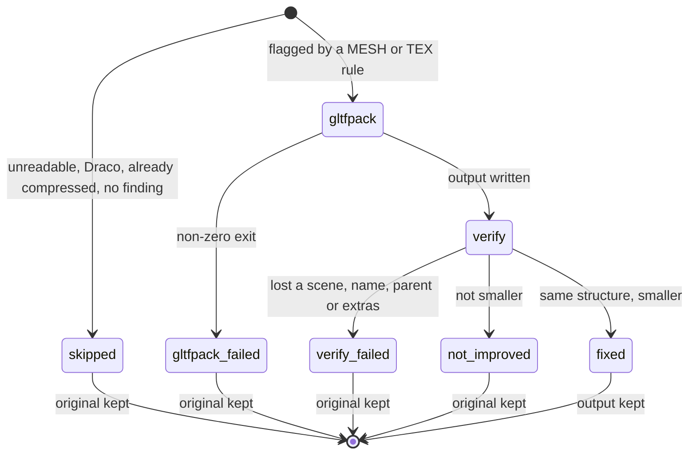

# meshdiet

Find the 3D models that make your website slow. meshdiet is a command line tool that reads the
`.glb` and `.gltf` files a site ships and tells you which ones are heavy and why: geometry with no
Draco or meshopt compression, textures that are too big, and a total nobody added up.

It is early work. Today `meshdiet scan` reads every model under a folder (container, JSON, external
files and image headers, nothing decoded), checks geometry, textures, embedded base64 data and size
budgets, checks that your app sets up the decoders its compressed models need, and adds up what every
model weighs. `meshdiet fix` compresses the flagged models with gltfpack. The first release will come
with install steps.

```console
$ meshdiet scan tests/fixtures/GLTF-001/bad --quiet
7 files · 7.1 KB · 7 high · 0 medium · 0 low · scanned in 0.00s
```

### Budgets

`meshdiet scan` ends with a weight table, largest file first, and can hold a site to a budget. Put a
`meshdiet.toml` next to where you run it (or pass `--config`):

```toml
[budgets]
file_max = "5 MB"     # SIZE-001, the default
build_max = "20 MB"   # SIZE-002, off unless set

[pages]
"/shop" = { assets = ["public/models/shop/**/*.glb"], max = "15 MB" }   # SIZE-003
```

Sizes are decimal (1 MB = 1,000,000 bytes). `--gzip` adds a gzip -6 transfer estimate per file; your
server may use brotli or nothing, so treat it as a rough guide.

### Decoders

A model compressed with Draco, meshopt or KTX2 only loads when the app sets up the matching decoder
in three.js. meshdiet searches the JS, TS and HTML in the scanned folder for that setup (`DRACOLoader`,
`MeshoptDecoder`, `KTX2Loader`, drei `useGLTF`, `<model-viewer>`) and reports LOAD-001 when it is
missing. If you scan only `public/`, point it at your code with `--src src`. It is a text search, so
it is marked "check by hand" and fails a build only with `--strict`; Babylon.js apps are skipped.

### Fixing what it finds

`meshdiet fix` hands the flagged models to [gltfpack](https://github.com/zeux/meshoptimizer/tree/master/gltf)
(meshoptimizer, MIT), which you install yourself: one file from the
[release page](https://github.com/zeux/meshoptimizer/releases). meshdiet runs it with flags that keep
your named nodes, named materials and extras, never simplifies a mesh, reads every output back, and
keeps the original whenever the output lost a name or did not get smaller.

```console
$ meshdiet fix public/models --dry-run        # see what you would save
$ meshdiet fix public/models --out public/models-opt
```

What happens to each model (`docs/diagrams/fix.mmd`):



Only `fixed` replaces anything; every other path keeps the original.

The sizes it prints are measured on disk after the fact, never estimated. Your loader then needs
`setMeshoptDecoder`; the report prints the three.js lines.

## Licence

Licensed under either of [Apache License, Version 2.0](LICENSE-APACHE) or [MIT license](LICENSE-MIT)
at your option.

Made by [UniqTech](https://uniqtech.dev).
