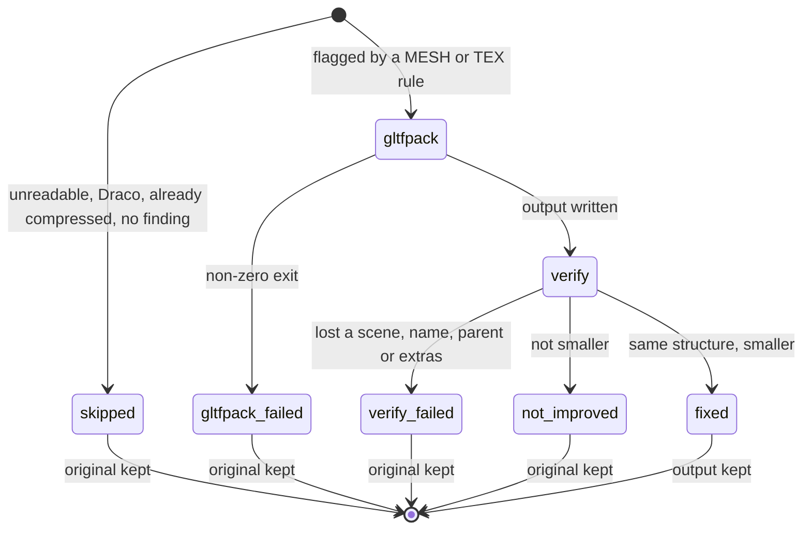

# meshdiet

Find the 3D models that make your website slow. meshdiet is a command line tool that reads the
`.glb` and `.gltf` files a site ships and tells you which ones are heavy and why: geometry with no
Draco or meshopt compression, textures that are too big, and a total nobody added up.

It is early work. Today `meshdiet scan` reads every model under a folder (container, JSON, external
files and image headers, nothing decoded), checks geometry, textures, embedded base64 data and size
budgets, checks that your app sets up the decoders its compressed models need, and adds up what every
model weighs. `meshdiet fix` compresses the flagged models with gltfpack. The first release will come
with install steps.

```console
$ meshdiet scan tests/fixtures/GLTF-001/bad --quiet
7 files · 7.1 KB · 7 high · 0 medium · 0 low · scanned in 0.00s
```

### Budgets

`meshdiet scan` ends with a weight table, largest file first, and can hold a site to a budget. Put a
`meshdiet.toml` next to where you run it (or pass `--config`):

```toml
[budgets]
file_max = "5 MB"     # SIZE-001, the default
build_max = "20 MB"   # SIZE-002, off unless set

[pages]
"/shop" = { assets = ["public/models/shop/**/*.glb"], max = "15 MB" }   # SIZE-003
```

Sizes are decimal (1 MB = 1,000,000 bytes). `--gzip` adds a gzip -6 transfer estimate per file; your
server may use brotli or nothing, so treat it as a rough guide.

If your build keeps each source model next to the compressed copy the app loads (`chair.glb` and
`chair-compressed.glb`, or gltfjsx's `chair-transformed.glb`), the source still counts in the weight
but its own findings are left out, unless your code loads it by name.

The same file sets the gate, what to scan and what to leave out. Unknown keys and rule ids are an
error, so a typo never switches a check off quietly:

```toml
fail_on = "high"            # high | medium | low | never; --fail-on wins
paths = ["public", "dist"]  # scanned when no PATH is given

ignore = [
  "**/fixtures/**",          # never scanned
  { rule = "TEX-001", path = "public/models/hero/*.glb", reason = "hero shot, shown full screen" },
]

[rules]
skip = ["TEX-002"]
```

An ignored finding needs a reason; an entry without one still applies but is reported as a low
`CFG-IGN` finding. `--show-ignored` lists what the entries keep out. `--rules` and `--skip` pick rules
for one run. `meshdiet rules` lists every rule, and `meshdiet explain MESH-001` says why one matters,
how to fix it with gltfpack or glTF Transform, and what the loader needs afterwards.

### On a site that is already heavy

Record where you are today, commit the file, and let CI fail only when something new appears or a
model grows by more than 1%:

```console
$ meshdiet scan tests/fixtures/demo-site --write-baseline meshdiet-baseline.json --quiet
meshdiet: wrote 7 findings and 4 files to meshdiet-baseline.json
4 files · 5.6 MB · 1 uncompressed (5.1 MB) · 2 high · 4 medium · 1 low · scanned in 0.00s
$ meshdiet scan tests/fixtures/demo-site --baseline meshdiet-baseline.json --quiet
4 files · 5.6 MB · 1 uncompressed (5.1 MB) · 0 high · 0 medium · 0 low · 7 in baseline · scanned in 0.00s
```

A file that grew past `--tolerance` (1% by default) is reported as `BASE-GROW`, and so is a build that
grew because of new files. Removed and smaller files are listed as improvements.

### Output for CI

`--format sarif` writes SARIF 2.1.0 for GitHub code scanning (each result points at the model file,
with the measured numbers in its properties and a stable fingerprint). `--format markdown` writes the
summary, findings, weight table and pages for a job summary or a pull request comment, for example
`meshdiet scan public --format markdown >> "$GITHUB_STEP_SUMMARY"`. `--format json` is for scripts.

### GitHub Action

The Action installs a meshdiet release for the runner (its SHA-256 checked against the release's
`SHA256SUMS`), scans, writes the Markdown report to the job summary, uploads SARIF to code scanning
and fails the job at `fail-on`. It needs no Rust on the runner and does not upload your models
anywhere; the summary and SARIF hold paths and numbers only. It works once the first release is out.

```yaml
# .github/workflows/meshdiet.yml
name: meshdiet
on: [pull_request]

permissions:
  contents: read
  security-events: write   # only for the SARIF upload; drop it with `sarif: "false"`

jobs:
  models:
    runs-on: ubuntu-latest
    steps:
      - uses: actions/checkout@v4
      - uses: uniqtechteam/meshdiet@v0
        with:
          path: public
          src: src
          fail-on: high
          version: v0.1.0   # pin the release you tested with
```

| Input | Default | What it does |
|---|---|---|
| `path` | `paths` in meshdiet.toml, else `.` | Folders or model files, separated by spaces or new lines |
| `src` | the scanned folder | App code searched for decoder setup (LOAD-001) |
| `config` | meshdiet.toml when there is one | Config file |
| `baseline` | none | Report only what is new or grew since this baseline |
| `fail-on` | `fail_on` in meshdiet.toml, else `high` | `high`, `medium`, `low` or `never` |
| `format` | `markdown` | Format of the report file kept for later steps (`markdown`, `json`, `sarif`, `pretty`) |
| `summary` | `true` | Write the Markdown report to the job summary |
| `sarif` | `true` | Upload SARIF to code scanning (skipped with a note on pull requests from forks) |
| `args` | none | Extra `meshdiet scan` flags, for example `--strict --skip TEX-002` |
| `version` | the tag the Action is used at, else the latest release | meshdiet release to install |
| `install-gltfpack` | `false` | Install gltfpack 1.3 (pinned zip, SHA-256 checked) on PATH for `meshdiet fix`; Linux x64, macOS arm64 and Windows x64 |

Outputs: `findings`, `high`, `medium`, `low`, `files`, `total-bytes`, `uncompressed-bytes`,
`exit-code`, `report-file`, `sarif-file` and `gltfpack`. With `format: markdown`, `report-file` is
ready to post as a pull request comment.

The downloaded `meshdiet` stays on PATH for the rest of the job, so with `install-gltfpack: "true"`
a later step can run `meshdiet fix public/models --out models-opt` and upload the result. The
meshdiet command itself never downloads gltfpack; only the Action does, at a pinned version.

### Decoders

A model compressed with Draco, meshopt or KTX2 only loads when the app sets up the matching decoder
in three.js. meshdiet searches the JS, TS and HTML in the scanned folder for that setup (`DRACOLoader`,
`MeshoptDecoder`, `KTX2Loader`, drei `useGLTF`, `<model-viewer>`) and reports LOAD-001 when it is
missing. When you scan a folder with no app code in it, such as `public/`, it reads the project around
it instead (the nearest folder above with a `package.json`, inside the same git repository); `--src`
points it somewhere else. It is a text search, so
it is marked "check by hand" and fails a build only with `--strict`; Babylon.js apps are skipped.

### Fixing what it finds

`meshdiet fix` hands the flagged models to [gltfpack](https://github.com/zeux/meshoptimizer/tree/master/gltf)
(meshoptimizer, MIT), which you install yourself: one file from the
[release page](https://github.com/zeux/meshoptimizer/releases). meshdiet runs it with flags that keep
your named nodes, named materials and extras, never simplifies a mesh, reads every output back, and
keeps the original whenever the output lost a name or did not get smaller.

```console
$ meshdiet fix public/models --dry-run        # see what you would save
$ meshdiet fix public/models --out public/models-opt
```

What happens to each model (`docs/diagrams/fix.mmd`):



Only `fixed` replaces anything; every other path keeps the original.

The sizes it prints are measured on disk after the fact, never estimated. Your loader then needs
`setMeshoptDecoder`; the report prints the three.js lines.

## Licence

Licensed under either of [Apache License, Version 2.0](LICENSE-APACHE) or [MIT license](LICENSE-MIT)
at your option.

Made by [UniqTech](https://uniqtech.dev).
