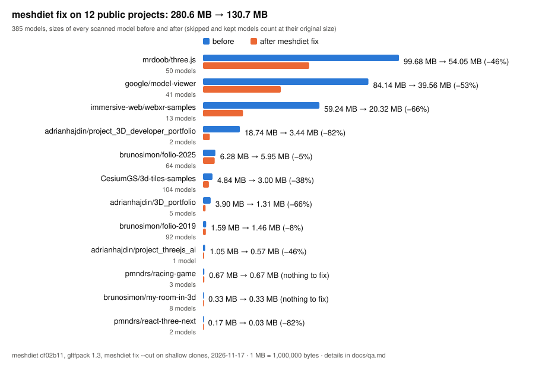

# Tested on 12 public projects

Before the first release, meshdiet was run on 12 public projects that ship glTF models, and every
finding was checked by hand. This page is the record of that run (2026-11-17).

meshdiet was at commit `df02b11` (release build), gltfpack 1.3. The projects were shallow clones
(`git clone --depth 1`, sparse where the repo is large); nothing in them was installed, built or run.
Only `meshdiet scan` and `meshdiet fix --out` were run. Every finding was checked by hand against the
glTF JSON and the image headers, and then re-derived for the whole set by a separate reader script
(glTF JSON, PNG IHDR/tRNS, buffer references): 211 of 211 agree. All numbers below are measured, not
estimated, except the GPU memory figures that meshdiet itself labels "est.". 1 MB = 1,000,000 bytes.

The chart is drawn by `scripts/qa_chart.py` from `docs/data/qa-fix.json`, which holds the "fix
before → after" column below.

## Headline

- **385 models, 541 files, 280.6 MB** across 12 projects, scanned in **379 ms** in total (first run;
  113 ms warm).
- **211 findings, 0 false positives** after the fixes in PR #11 (before: 217 findings, 11 false).
- Most common: **MESH-001 uncompressed geometry, 84** (83 high, 1 medium); TEX-004 image over 1 MB, 34;
  TEX-002 GPU memory over 32 MB (low), 27; TEX-003 PNG with no alpha, 24.
- **`meshdiet fix` changed 79 models: 224.7 MB → 71.0 MB (−68%)**; median output 20% of the input.
  Whole scanned set 280.6 MB → 130.7 MB. 301 models were skipped on purpose (Draco, already meshopt or
  KTX2, no finding, or the source of a compressed copy) and 5 were kept because gltfpack would have
  dropped data (see below).
- 7 projects already used Draco and/or KTX2 for some or all models; each of them wires the decoder,
  so LOAD-001 rightly found nothing.

## Per repository

TP / FP = true / false positives after the fixes; "before" is the same scan on `main` before PR #11.
`fix` columns are the bytes of every scanned model before and after `meshdiet fix --out` (skipped and
kept models count at their original size).

| Repository (commit) | Models / files | Total | Findings by rule | TP / FP (before) | fix before → after | Notes |
|---|---|---|---|---|---|---|
| [mrdoob/three.js](https://github.com/mrdoob/three.js/tree/484850fa1a5ff3be350f4e01c5d1cd68c5c67b96) `examples/models`, `--src examples` | 50 / 66 | 99.68 MB | MESH-001 29 · SIZE-001 5 · TEX-001 6 · TEX-002 18 · TEX-003 14 · TEX-004 12 | 84 / 0 (80 / 0) | 99.68 → 54.05 MB | Sample models for the examples; 15 already Draco, 3 KTX2. 4 palette PNGs (anisotropy and metal/roughness maps, 0.5 to 2.8 MB) newly flagged by TEX-003. `fix` on PrimaryIonDrive.glb used to fail verification over a node named `""`; now 5.80 → 0.46 MB. ShaderBall.glb (quantized only) 1.44 → 0.32 MB. |
| [google/model-viewer](https://github.com/google/model-viewer/tree/d1124d71432e05a2d7e8ea5ecbe41333bad0b350) `packages/shared-assets/models`, `packages/modelviewer.dev` | 41 / 41 | 84.14 MB | MESH-001 26 · SIZE-001 6 · TEX-001 3 · TEX-002 7 · TEX-003 4 · TEX-004 9 · GLTF-002 3 | 58 / 0 (58 / 0) | 84.14 → 39.56 MB | Many are test models for the viewer itself, chosen to vary. `boom_2_.glb` 10.85 → 1.09 MB, `pbr-spheres.glb` 2.35 MB → 26 KB. 3 outputs kept back: gltfpack drops `EXT_mesh_manifold` / `EXT_manifold`. `<model-viewer>` wires every decoder. |
| [immersive-web/webxr-samples](https://github.com/immersive-web/webxr-samples/tree/38d24f39ebaff7353946a5465a3bb15213f2847e) | 13 / 96 | 59.24 MB | MESH-001 7 · SIZE-001 1 · TEX-002 1 · TEX-004 11 | 20 / 0 (20 / 0) | 59.24 → 20.32 MB | Sponza.gltf 52.73 → 19.18 MB, cube-room 2.63 → 0.21 MB. Its PNGs are RGBA, so no TEX-003. The samples use their own glTF loader, which would need meshopt and WebP support before using the fixed files; LOAD-001 only judges three.js-family loaders, so it stays quiet. |
| [CesiumGS/3d-tiles-samples](https://github.com/CesiumGS/3d-tiles-samples/tree/a30bfdf2d6cc55f4c3078e8aea3a793af6ebfd56) | 104 / 106 | 4.84 MB | MESH-001 11 · MESH-003 16 | 27 / 0 (27 / 7) | 4.84 → 3.00 MB | 7 MESH-003 were `EXT_structural_metadata` property tables (fixed). The 16 left are real: 138.4 KB per file of bufferViews nothing references, one of them a 1024² PNG no image points at. 2 point clouds kept back: gltfpack drops `EXT_structural_metadata` and `_INTENSITY` / `_CLASSIFICATION`. |
| [adrianhajdin/project_3D_developer_portfolio](https://github.com/adrianhajdin/project_3D_developer_portfolio/tree/9985e4bf4ce35dfbc0b3c0e90d4d37dc3c67b2d7) | 2 / 57 | 18.74 MB | MESH-001 2 · SIZE-001 1 · TEX-001 1 · TEX-002 1 · TEX-003 6 · TEX-004 2 | 13 / 0 (12 / 0) | 18.74 → 3.44 MB | Two `.gltf` models with 51 external textures; the desktop model is 15.7 MB (685 primitives, a 3840×2160 2.9 MB JPEG). One palette PNG newly flagged. Loaded with drei `useGLTF`, so meshopt output loads as is. |
| [adrianhajdin/3D_portfolio](https://github.com/adrianhajdin/3D_portfolio/tree/057380c3c325838333094e3fe2f68ec8403e9d9d) | 5 / 5 | 3.90 MB | MESH-001 3 | 3 / 0 (3 / 0) | 3.90 → 1.31 MB | Models in `src/assets/3d` (bundled by Vite). Two already Draco + WebP; bird, plane and sky are not. |
| [adrianhajdin/project_threejs_ai](https://github.com/adrianhajdin/project_threejs_ai/tree/bbe1d55b16267a9d115555be8ed2e2a2e2bb957b) | 1 / 1 | 1.05 MB | MESH-001 1 | 1 / 0 (1 / 0) | 1.05 → 0.57 MB | Shirt configurator; 453.5 KB float32 geometry. |
| [pmndrs/react-three-next](https://github.com/pmndrs/react-three-next/tree/bb29a61949601e1c563688faf33a12d062ec3710) | 2 / 2 | 0.17 MB | MESH-001 2 | 2 / 0 (2 / 0) | 0.17 → 0.03 MB | Starter; two 78 KB models, 83 KB → 17 KB each. |
| [brunosimon/folio-2019](https://github.com/brunosimon/folio-2019/tree/540f13573a6da282eae942a4c67335b97cd18970) | 92 / 92 | 1.59 MB | MESH-001 1 | 1 / 0 (1 / 0) | 1.59 → 1.46 MB | 50 Draco models; 39 plain ones are collision meshes under 16 KB, rightly below the 64 KB minimum. The app wires `DRACOLoader` only, so the meshopt output needs `setMeshoptDecoder`: scanning the fixed output with `--src src` gives LOAD-001, as it should. |
| [brunosimon/folio-2025](https://github.com/brunosimon/folio-2025/tree/70764a94756cc4de564e493c8ba46c4b5fe03ed1) `static/` (sparse: models, sources) | 64 / 64 | 6.28 MB | MESH-001 2 | 2 / 0 (2 / 4) | 6.28 → 5.95 MB | Every model ships as `X.glb` plus `X-compressed.glb` (Draco + KTX2) and the game loads the copy. 4 MESH-001 on originals were false (fixed). The 2 left are the two vehicles the Konami code loads by name, uncompressed. LOAD-001 now finds `sources/` without `--src`. |
| [brunosimon/my-room-in-3d](https://github.com/brunosimon/my-room-in-3d/tree/5d00b3f870da81f103e901e0d12e20bbcc816834) | 8 / 8 | 0.33 MB | none | 0 / 0 (0 / 0) | 0.33 → 0.33 MB | 5 Draco models, 3 tiny plain ones; baked textures are separate JPEGs outside the glTF files. Clean. |
| [pmndrs/racing-game](https://github.com/pmndrs/racing-game/tree/7816a5d954b75e6ad853ae4e4f0cbbd628072643) | 3 / 3 | 0.67 MB | none | 0 / 0 (0 / 0) | 0.67 → 0.67 MB | All Draco, loaded with `useGLTF`. Clean. |

A 13th clone, sanidhyy/3d-portfolio, ships the same two models as the first portfolio above (same
tutorial), so it is left out of the totals.

## False positives found and fixed (PR #11)

| Class | Where | Fix | Test |
|---|---|---|---|
| MESH-003 on `EXT_structural_metadata` property tables (`values`, `arrayOffsets`, `stringOffsets` name bufferViews without a `bufferView` key) | 3d-tiles-samples, 7 | counted as users | `MESH-003/good/tile-metadata.glb`, unit test |
| Per-file findings on a source model next to the compressed copy the app loads (`X.glb` + `X-compressed.glb`, also `-draco`, `-meshopt`, `-ktx2`, `-transformed` from gltfjsx, ...) | folio-2025, 4 | per-file rules skip the original unless the app's code names it; it still counts in the weight and is marked `(source of ...)` | `MESH-001/good/dense.glb`, integration test with the easter-egg case |

Before: 11 false positives in 12 projects (0.92 per project, but all in two). After: none found.

## False negatives and silent failures fixed

- **TEX-003 skipped palette PNGs** with no `tRNS`, which cannot be transparent either: 5 found
  (three.js AnisotropyBarnLamp 1.30 / 2.79 / 0.57 MB, LittlestTokyo 0.50 MB, portfolio 0.65 MB).
- **LOAD-001 never ran on `meshdiet scan public`**: no sources in `public/`, so it stayed quiet. It now
  reads the nearest folder above with a `package.json` (inside the same git repository) when the scanned
  folder has no three.js loader.
- **`fix` passed outputs that lost data**: gltfpack drops unknown extensions and custom attributes. The
  check now compares `extensionsUsed` and `_NAME` attributes and keeps the original (5 models above).
- **`fix` refused a good output** because a node named `""` counted as named (PrimaryIonDrive.glb).

## Defaults, against the data

| Default | Seen | Decision |
|---|---|---|
| MESH-001 `compress_min` 64 KB | Smallest flag 70.6 KB (Stork.glb, 76.9 → 20.3 KB). 16 of 84 under 128 KB, all shrank 74 to 88%. Below 64 KB: dozens of collision and helper meshes of a few KB, rightly silent. | keep |
| MESH-001 severity high | 83 high findings, all true; median fixed output 20% of input. Quantized-only ShaderBall (medium) still shrank 78%. | keep high; quantized-only stays medium |
| MESH-002 500,000 triangles | Largest drawn: 358,788 (ferrari.glb), then 332,258 (coffeemat.glb). No finding. | keep; no evidence either way |
| TEX-001 2048 px | 468 images: 111 at exactly 2048, 10 above (4096 and 3840), all flagged rightly. 1024 would flag every standard PBR map. | keep |
| TEX-004 1 MB | 34 findings, smallest 1.0 MB 1024² JPEGs in Sponza; all real. | keep |
| SIZE-001 5 MB | 13 findings from 5.1 to 52.7 MB. | keep |
| TEX-002 32 MB est. GPU, severity low | 27 findings: any model with two or more 2048² textures crosses it. KTX2 needs a transcoder in the app, so it is advice, not a gate. | keep low |

No default changed.

## Speed

Generated set, 200 models / 519 MB, release build: **15 ms** with a warm page cache
(`cargo test --release -p meshdiet-core --test speed -- --ignored --nocapture`). A 1.1 GB variant of
the same set took 151 ms. On the real repos above, three.js (99.7 MB, 66 files) took 213 ms on the first
run.

## Limits of this sample

- Mostly examples, starters and portfolios; model-viewer and three.js ship test models on purpose, so
  their counts say little about how those projects' own pages load.
- Sparse clones for three.js, model-viewer and folio-2025: only models and the code that loads them.
- No project was contacted, and nothing here is a security issue. These are example and portfolio
  repositories, many of them made to teach; a finding says what a file weighs, not that anyone did
  something wrong.
